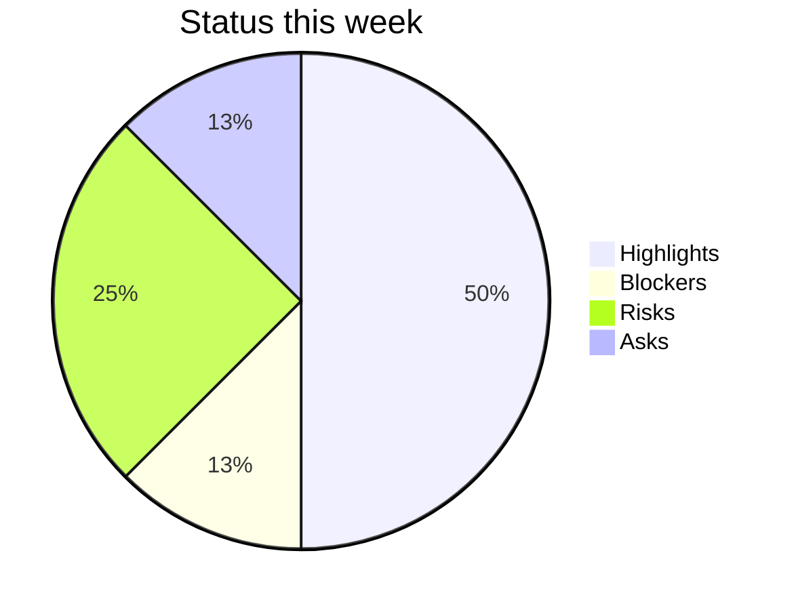

> This skill also ships helper scripts (Python). They are not included here; the instructions work without them.

# Status Update Generator

## Overview

Weekly status updates eat 30-90 minutes of every PM's Friday afternoon and they almost always say the same thing in subtly different ways. This skill standardizes the artifact: pull tickets from Jira or Linear (or any JSON dump), and emit a structured update with five named sections -- Highlights, Blockers, Risks, Asks, What's Next -- plus a traffic-light status (Red / Yellow / Green) for the period. The structure follows **SBNR** (Status / Blockers / Next / Risks) and a condensed Amazon **6-pager** narrative for Highlights; the stoplight verdict follows classic R/Y/G reporting.

## Core Capabilities

- **Header plus five sections** — Header (project, period, author, R/Y/G and rationale), then Highlights, Blockers, Risks, Asks, What's Next, in a fixed order so exec readers scan in under 5 seconds (full section definitions in `references/status-structure-and-workflow.md`).
- **Traffic-light discipline** — Green / Yellow / Red rules plus anti-patterns (watermelon status, always-yellow, color creep).
- **Multi-format rendering** — `status_generator.py` emits all six SHARED_OUTPUT_SCHEMA formats: `markdown`, `confluence`, `notion`, `linear`, `json`, `mermaid`.
- **SBNR mapping** — compressed async-standup variant mapped to the weekly sections.

## When to Use

- **Weekly exec status update** -- the standard Friday/Monday cadence brief sent to a sponsor, VP, or steering committee.
- **Monthly board / leadership packet** -- aggregate four weekly updates into a monthly view.
- **Sprint review summary** -- end-of-sprint communication that travels outside the team.
- **Cross-team async standup** -- distributed teams where a written async update replaces a sync meeting.
- **Project kickoff status baseline** -- the first status update establishes the template and traffic-light baseline.

**When NOT to use:** real-time incident response (use `delivery-manager/` incident skills), deep retrospectives (use `sprint-retrospective/`), or one-to-one stakeholder reporting needing custom framing (use `roadmap-communication/`).

## Clarify First

Before generating the update, settle the inputs below. When one is missing or vague and would change the result, ask about it; when it wouldn't, use a sensible default and say which one you used.

- **Traffic-light verdict (R/Y/G):** the human judgment the tool will not infer; sets the whole frame and must be defensible (prevents watermelon status).
- **Audience:** sponsor, VP, or steering committee (sets altitude and what belongs in Highlights vs Asks).
- **This period's wins + blockers with real numbers:** quantitative claims must come from telemetry, not ticket titles (fills Highlights and Blockers).
- **The asks:** the specific decisions or help you need from the reader this week (drives the Asks section).

Ask about the two or three inputs that matter most for this request, not the whole list. If the user wants a result straight away, produce it and state your assumptions at the top.

## Quick Start

```bash
# Render the sample week (status yellow, one blocker, two risks) as markdown
python3 scripts/status_generator.py \
  --input assets/sample_status.json --format markdown
# Same data as a Confluence page body; --status overrides the file's R/Y/G
python3 scripts/status_generator.py \
  --input assets/sample_status.json --format confluence --status red
```

Formats: `markdown` (default), `confluence`, `notion`, `linear`, `json`, `mermaid`; `--output FILE` writes a file, `--period` overrides the period label, `--demo` uses the built-in copy of the sample. Input shape and flags: `references/tool-and-troubleshooting.md`.

The traffic-light status is a human judgment, not a calculation: the tool refuses to run without one (`status` in the file or `--status`) rather than defaulting to green. Write the rationale next to it.

**Exit codes:** `0` update rendered · `2` missing or unreadable file, invalid JSON, a top level that is not an object, or no valid `status`.

## Anti-Patterns

### Activity reported as progress
**Mistake:** Highlights list what the team did ("held kickoff with vendor", "started integration spec") instead of what changed.
**Why it happens:** Activity is easy to pull from ticket titles and calendars, and it makes a slow week look busy.
**Instead:** Give each highlight a completion verb or a measurable change: a decision made, a milestone hit, a metric moved. "Started", "held" or "discussed" with no decision is activity. Put at least 3 numbers in Highlights.

### Risks copied forward unchanged
**Mistake:** The same risk line ("vendor SDK might change") appears word for word from week 1 to week 6.
**Why it happens:** Last week's update is the easiest template, and editing a risk means checking on it.
**Instead:** Each week, mark every risk as mitigated, worse, or now an issue, and update its mitigation. A risk unchanged across 3 updates gets resolved, escalated or re-planned. If less than 30% of the update changed since last week, re-baseline or escalate.

### Generating from a stale export
**Mistake:** The Jira or Linear export feeding `status_generator.py` is several days old, so the update reports last week's state as current.
**Why it happens:** Refreshing the export is a separate manual step, and the tool runs fine on old data.
**Instead:** Check the export timestamp before you run the tool, and re-export anything older than 24 hours. The tool does not check freshness for you.

Seven more, each with a bad and a good example: `references/red-flags.md`.

## Reference Documentation

Load the reference that matches the task — keep this file lean and pull detail on demand:

- **[references/status-structure-and-workflow.md](references/status-structure-and-workflow.md)** — full definition of the header and the five sections, R/Y/G rules and anti-patterns, SBNR shorthand mapping, and the 6-step authoring workflow. Read when writing or standardizing an update.
- **[references/status-update-style-guide.md](references/status-update-style-guide.md)** — voice, structural rules, traffic-light discipline, and 5 worked examples (Green / Yellow / Red across team types). Read when coaching writing quality or seeing full examples.
- **[references/red-flags.md](references/red-flags.md)** — warning signs and failure modes in status reporting practice. Read when an update process feels performative or untrusted.
- **[references/tool-and-troubleshooting.md](references/tool-and-troubleshooting.md)** — `status_generator.py` flags, input JSON shape, Mermaid output, troubleshooting table, and success criteria. Read when running the tool or diagnosing a problem.
- **[assets/weekly_status_template.md](assets/weekly_status_template.md)** — fill-in template matching the tool's input JSON structure. Use to draft an update by hand.

## Scope & Limitations

**In Scope:**
- Generating weekly executive status updates from structured input
- Header plus five sections (Highlights / Blockers / Risks / Asks / What's Next) with an R/Y/G traffic light
- Output in all six SHARED_OUTPUT_SCHEMA formats (json, markdown, mermaid, confluence, notion, linear)
- Aggregating ticket data from Jira-shaped or Linear-shaped JSON dumps
- SBNR shorthand mapping for async standup variants

**Out of Scope:**
- Pulling data directly from Jira or Linear APIs (use the Atlassian MCP, Linear MCP, or `linear-expert/`/`jira-expert/` skills to export the JSON first)
- Sprint analytics or velocity calculation (use `../scrum-master/`)
- Incident communication or postmortems (use `delivery-manager/`)
- Long-form retrospective output (use `sprint-retrospective/`)
- Tailoring updates to multiple audiences in different framings (use `roadmap-communication/`)

**Important Caveats:**
- The traffic-light status is a human judgment. The tool will not infer it from ticket counts. Forcing automation here produces watermelon updates.
- Quantitative claims in Highlights ("latency down to 210ms") must come from real telemetry, not from the ticket title. The tool will not verify these.
- Status updates are most effective on a predictable cadence. A high-quality irregular update is worse than a mediocre regular one.

## Integration Points

| Integration | Direction | Description |
|-------------|-----------|-------------|
| `../jira-expert/` | Receives from | Jira JQL exports or MCP pulls feed the input JSON |
| `linear-expert/` | Receives from | Linear GraphQL exports feed the input JSON |
| `../senior-pm/` | Feeds into | Weekly updates aggregate into monthly portfolio reports; risks lift into the portfolio risk register |
| `../scrum-master/` | Pairs with | Sprint health scores supply the Highlights/Risks context |
| `roadmap-communication/` | Pairs with | Weekly status feeds the executive-variant roadmap narrative |
| `sprint-retrospective/` | Feeds into | Four weeks of status archives become retrospective input |
| `../program-manager/` | Feeds into | Cross-team status aggregation rolls up multiple team updates |
| `../delivery-manager/` | Pairs with | Release windows and incident references show up in Highlights and Risks |

## Files

| File | Purpose |
|------|---------|
| `scripts/status_generator.py` | Renders the update in six output formats |
| `assets/sample_status.json` | One week of status data (same as `--demo`) |
| `assets/weekly_status_template.md` | Fill-in template matching the input JSON |

---

# Reference material

Where the instructions above say to read a `references/` file, use the matching section below.

## references/red-flags.md

# Red Flags: Status Update Generator

> Common ways this skill's output goes wrong -- concrete examples, why they're bad, and how to fix them.

## How to use this document

Scan every weekly status update before it goes to a sponsor, VP, or steering committee. Each red flag has bad and good quoted examples.

---

## Red Flag 1: Watermelon Status

**Symptom.** The traffic-light shows GREEN but the body of the update lists 4 risks and 2 blockers.
**Why it's bad.** Watermelon status (green outside, red inside) is the leading symptom of a culture that punishes bad news. By the time the sponsor sees the red, it is too late to help. Trust craters.
**Bad example:**
> "Status: GREEN.
> Blockers: vendor SDK breaking change blocking integration; QA environment down 3 days.
> Risks: scope expanded by Sales commitment; team lead on PTO for the next 2 weeks."
**Good example:**
> "Status: YELLOW (was GREEN last week).
> Reason: vendor SDK breaking change is a hard blocker; QA env down has lost 3 dev-days. With these resolved this week, recoverable to GREEN. Mitigation in Asks #1 and #3."
**How to catch it.** If the body contains items in Blockers or Risks, the traffic light must be at least YELLOW. Build this as a generator rule.

---

## Red Flag 2: Missing Asks Section

**Symptom.** Status update has Highlights / Blockers / Risks / What's Next, but no Asks.
**Why it's bad.** Asks are the only way the sponsor can actually help. Without them the update is just a report. The sponsor reads, nods, files it away, and the team's blockers do not get unblocked.
**Bad example:**
> "Highlights: A, B, C.
> Blockers: vendor SDK issue.
> Risks: scope creep.
> What's Next: integration testing.
> (No Asks section.)"
**Good example:**
> "...
> **Asks** (decisions / help needed from you this week):
> 1. Approve emergency budget for backup vendor evaluation (~$8k, 2-week trial).
> 2. Decide: ship with degraded SDK or wait 3 weeks for vendor fix.
> 3. Help unblock QA env (need IT director to assign owner)."
**How to catch it.** Status update with no Asks = either the project is dead-perfect (rare) or the team is reporting, not collaborating. Rewrite.

---

## Red Flag 3: Activity Reported as Progress

**Symptom.** Highlights list activities ("had 4 meetings with vendor", "started working on integration spec") instead of outcomes.
**Why it's bad.** Activities consume capacity without producing value. Sponsors care about outcomes -- decisions made, milestones hit, metrics moved. Activity reports signal a team that is busy but not delivering.
**Bad example:**
> "Highlights:
> - Held kickoff with vendor.
> - Started integration spec.
> - Reviewed 3 design proposals."
**Good example:**
> "Highlights:
> - Vendor commercial terms signed (5% discount vs initial quote).
> - Integration spec complete and approved; engineering starts Monday.
> - Picked design proposal C; in build."
**How to catch it.** Each highlight should have a past-tense verb of completion or a measurable change. "Started", "held", "discussed" without a decision = activity, not progress.

---

## Red Flag 4: Same Update Three Weeks in a Row

**Symptom.** The current update is 90% the same text as last week's, which was 90% the same as the week before's.
**Why it's bad.** A static update means nothing moved -- but it is being reported as if work is happening. The sponsor either ignores the update (lost signal) or assumes silent failure. Either way trust drops.
**Bad example:**
> "Week 1: 'Working on vendor integration. ETA 2 weeks.'
> Week 2: 'Working on vendor integration. ETA 2 weeks.'
> Week 3: 'Working on vendor integration. ETA 2 weeks.'"
**Good example:**
> "Week 3: 'Vendor integration paused 5 days due to SDK breaking change (see Blockers). Net: ETA slipped 1 week to <date>. We have used 9 of the 14 planned dev-days; remaining work is integration testing only.'"
**How to catch it.** Diff this week's update against last week's. < 30% changed text = something is wrong; either re-baseline or escalate.

---

## Red Flag 5: Risk Section Recycled Verbatim Each Week

**Symptom.** "Risk: vendor SDK might change before integration is complete" -- copied from week 1 to week 6 unchanged.
**Why it's bad.** Risks should evolve -- get mitigated, get worse, or become issues. Static risks signal nobody is actively managing them, which means by the time they fire there is no plan.
**Bad example:**
> "Risk (week 1, week 6, same text): 'Vendor SDK might change.'"
**Good example:**
> "Risk (week 1): 'Vendor SDK might change; mitigation: SDK pinned to v2.4; spike planned week 3.'
> Risk (week 3, updated): 'Vendor SDK breaking change confirmed in 2.5; mitigation: forking SDK for our use case; cost = 4 dev-days.'
> Risk (week 6, updated): 'Resolved -- vendor accepted our PR upstream; SDK fork merged back.'"
**How to catch it.** Any risk that has not changed wording in 3 status updates = either resolve, escalate, or update mitigation.

---

## Red Flag 6: No Numerical Anchor

**Symptom.** "Project is going well." -- no numbers, no progress percentage, no metric.
**Why it's bad.** Sponsors cannot compare progress across projects without numbers. They cannot trace trends. They cannot triage where to spend their attention. Narrative-only updates produce vibes-driven leadership.
**Bad example:**
> "Highlights: things are progressing nicely. Most work is on track."
**Good example:**
> "Highlights:
> - 14 of 22 backlog stories complete (64%), up from 9 last week (41%).
> - Beta enrolled 38 of 50 target customers; 4 are actively logging in daily.
> - 2 of 3 launch-readiness gates passed; 1 (security review) in progress."
**How to catch it.** No numbers in the Highlights section = rewrite with at least 3 concrete metrics.

---

## Red Flag 7: Update Includes Internal Drama

**Symptom.** Status update has lines like "frustrated with marketing's lack of engagement" or "engineering pushing back on scope".
**Why it's bad.** Sponsors get the wrong signal -- they see a people problem, not a project problem. The drama gets amplified up the org, and the actual project status is lost. Worse, the targeted team retaliates.
**Bad example:**
> "Blockers: marketing has not delivered the messaging brief despite 3 requests; this is causing slippage."
**Good example:**
> "Blockers: messaging brief outstanding (planned week 2, now 2 weeks late). Asked Marketing for revised ETA in the cross-team sync; owner is <name>. **Ask for sponsor**: escalate prioritization in next CMO 1:1 if not resolved by Friday."
**How to catch it.** Any emotional language ("frustrated", "pushback", "not engaging") in a status update = rewrite with neutral, factual blockers and a specific ask.

---

## Red Flag 8: One Status Update for All Stakeholders

**Symptom.** The same update goes to the engineering team, the exec sponsor, and the customer advisory board.
**Why it's bad.** Each audience has different stakes and different attention budgets. Engineering wants ticket-level detail; sponsors want outcomes; customers want themes. A one-size update annoys all three.
**Bad example:**
> "Single weekly update emailed to: dev-team@, vp-eng@, board-advisors@."
**Good example:**
> "Three views, one source:
> - **Engineering**: full ticket-level update + WIP + cycle time (in Slack #eng-updates).
> - **Exec sponsor**: 5 highlights + traffic light + asks (1-page email).
> - **Customer advisors**: themes + visible-to-customer changes only (Productboard digest)."
**How to catch it.** Same recipient list for two different stakeholder types = split.

---

## Red Flag 9: "What's Next" That Could Have Been Written in Week 1

**Symptom.** Every "What's Next" section reads "continue work on integration; QA next".
**Why it's bad.** Generic "What's Next" signals the team is operating from a static plan, not learning week to week. Sponsors cannot see emerging decisions or new bets. The update becomes a ritual.
**Bad example:**
> "What's Next: continue integration work, then QA, then launch."
**Good example:**
> "What's Next (this week's decisions, in order):
> 1. Mon -- vendor decision (stay or switch).
> 2. Wed -- scope decision (descope flow C or extend by 1 week).
> 3. Fri -- launch-readiness gate review with security."
**How to catch it.** Generic phrasing or no specific decisions in What's Next = rewrite with the week's actual forks.

---

## Red Flag 10: Generated from Stale Data

**Symptom.** The Jira / Linear export feeding the generator is 5 days old, so the update reflects last week's state.
**Why it's bad.** A status update from stale data is worse than no update -- it confidently presents an old reality. Decisions are made on it; teams find out a week later that the data was wrong.
**Bad example:**
> "Highlights: 14 of 22 stories complete. (Generated from `jira-export.json` last refreshed 5 days ago.)"
**Good example:**
> "The export is refreshed every Friday at 09:00, and the PM checks its timestamp before generating. Anything older than 24 hours is re-exported first, and the update states when the data was pulled."
**How to catch it.** `status_generator.py` reports whatever the input file says and does not check its age. Look at the export's timestamp before running it; if it is older than a day, re-export.

---

## Red Flag Quick Reference

| # | Anti-pattern | One-line check |
|---|---|---|
| 1 | Watermelon status | GREEN with > 0 Blockers / Risks = wrong |
| 2 | Missing Asks | Every status has at least 1 Ask |
| 3 | Activity as progress | Each highlight has past-tense outcome verb |
| 4 | Same update 3 weeks running | < 30% changed text = escalate |
| 5 | Risks recycled verbatim | Static risk for 3 weeks = act on it |
| 6 | No numerical anchor | Highlights have >= 3 numbers |
| 7 | Internal drama in body | Emotional language = rewrite |
| 8 | Single update for all | Audience-specific views? |
| 9 | Generic "What's Next" | Specific decisions for the week? |
| 10 | Stale data | Generator rejects > 24-hour-old export |

## Related Reading

- `SKILL.md` -- the SBNR + 6-pager + traffic-light pattern
- `scripts/status_generator.py --help` -- the generator (it does not check how old the input is)
- Sibling skill: `execution/dependency-map/` -- track cross-team blockers
- Sibling skill: `execution/cycle-time-analyzer/` -- numbers to put in Highlights
- Sibling skill: `execution/roadmap-communication/` -- audience segmentation patterns
- Sibling skill: `program-manager/` -- multi-project status aggregation

## references/status-structure-and-workflow.md

# Status Update Structure & Workflow

Read this when you need the full definition of each of the six sections, the traffic-light rules and anti-patterns, the SBNR shorthand mapping, or the step-by-step authoring workflow.

## The status update structure

Every update produced by this skill has the same six sections, in this order. Consistency is the point -- exec readers should be able to scan to the section they care about in under 5 seconds.

### Section 1: Header

- **Period**: the date range covered (e.g., "Week of 2026-05-18")
- **Project / team**: the name of the team or initiative
- **Author**: the PM or engineering lead
- **Status (R / Y / G)**: the single overall traffic-light verdict
- **Status rationale**: one sentence explaining why this color

### Section 2: Highlights

Three to five bullet points describing the most important things that shipped, decided, or moved this week. Highlights are **outcome-led**: name what changed for the user or the business, not the activity.

**Bad:** "Shipped PR-1234"
**Good:** "Search latency dropped from 480ms p95 to 210ms p95 after the index rebuild (PR-1234)"

Each highlight should pass the **"so what?" test**: a busy exec who reads only this bullet should understand why it matters.

### Section 3: Blockers

Things currently stopping the team. Each blocker has three parts:

- **What is blocked**: the work item or workstream
- **Who/what is blocking**: the team, vendor, decision, or dependency
- **What we need**: a specific ask or decision

A blocker without a specific ask is a complaint, not a blocker. Promote it to Risks or strike it.

### Section 4: Risks

Things that could become blockers if we do not act. Each risk follows the format:

`<Risk> -- Likelihood (H/M/L) x Impact (H/M/L) -- Mitigation: <action> -- Owner: <name> -- Due: <date>`

This is the format used by `senior-pm/risk_matrix_analyzer.py` so risks can be lifted directly into the portfolio risk register.

### Section 5: Asks

Specific decisions, approvals, resources, or introductions needed from the audience. Each ask names:

- **What you want**
- **By when**
- **From whom**
- **Consequence of delay**

An update without an "Asks" section trains readers that updates require no action. Always include the section, even if the answer is "none this week."

### Section 6: What's Next

The 3-5 most important things planned for the coming week. Same outcome-led style as Highlights. This is the closing read -- it sets expectations for next week's update.

## Traffic-light status (R / Y / G)

| Color | Definition | Rule |
|-------|------------|------|
| **Green** | On track. No active blockers; risks are manageable; commitments will be met. | Use sparingly. Two consecutive Green updates with no new highlights is suspicious. |
| **Yellow** | At risk. There is an issue, but the team has a credible mitigation in flight. | The Risks section must name the mitigation, the owner, and the deadline. |
| **Red** | Off track. Intervention from leadership is required. | A Red update requires an explicit Ask. Red without an Ask means the PM has not done their job. |

### Anti-patterns

- **Watermelon status** -- Green outside, Red inside. The most common failure. Surface the bad news in the rationale sentence.
- **Always-Yellow** -- if every update is Yellow, the team has not made the decision to commit (Green) or to escalate (Red).
- **Color creep** -- the bar for Red should not move week to week. Document the criteria in the team wiki.

## SBNR shorthand

Some teams use SBNR (Status / Blockers / Next / Risks) as a compressed version for daily or async standup. SBNR maps to this skill's sections as follows:

| SBNR field | Section in this skill |
|------------|----------------------|
| **S**tatus | Section 1 (Header) + Section 2 (Highlights) |
| **B**lockers | Section 3 (Blockers) |
| **N**ext | Section 6 (What's Next) |
| **R**isks | Section 4 (Risks) |

The Asks section is unique to the weekly executive variant -- daily SBNR typically does not include explicit asks.

## Workflow

1. **Export ticket data.** Pull from Jira (via JQL or the Atlassian MCP), Linear (via GraphQL or the Linear MCP), or any source that can emit JSON matching the input schema (see Tool Reference).
2. **Augment with narrative.** The PM adds 1-2 sentences of context to each highlight that goes beyond what the ticket title says.
3. **Run `status_generator.py`.** Use `--input status_data.json --format markdown` to render the update. Use `--format confluence` or `--format notion` to push directly to a wiki.
4. **Set the traffic-light status.** This is a human judgment, not a calculation. Document the rationale.
5. **Distribute.** Send via the agreed channel. Always include the Asks section, even if "none this week."
6. **Archive.** Save dated copies. The weekly archive becomes the monthly packet and the quarterly retrospective input.

## references/status-update-style-guide.md

# Status Update Style Guide

A reference on writing voice, structural rules, traffic-light discipline, and 5 worked examples covering Green / Yellow / Red updates across different team types.

---

## Voice and structure

### The cardinal rule: outcome over activity

A weekly update is a contract with the reader: in exchange for 60 seconds of attention, they get the state of the world. Activity-led updates ("we shipped X PRs") break the contract because they require translation. Outcome-led updates ("search latency dropped from 480ms to 210ms after the index rebuild shipped") deliver state directly.

| Activity-led (avoid) | Outcome-led (use) |
|----------------------|-------------------|
| Shipped PR-1234 | Search latency p95 dropped from 480ms to 210ms (PR-1234) |
| Held 3 customer interviews | 3 customer interviews confirm that the top onboarding friction is account verification |
| Completed sprint 23 | Sprint 23 delivered the SSO MVP; first pilot tenant configured this week |
| Wrote PRD for Feature X | Feature X PRD signed off by all 5 reviewers; build kicks off Monday |

### Length and cadence

- **One screen / one page max.** If the reader needs to scroll twice, the update is too long.
- **Same day, same time, every week.** Predictability beats polish.
- **5 bullets per section max.** Force prioritization. If you have 8 highlights, the top 3 do not stand out.

### Tone

- **Direct, not breezy.** Avoid "we're absolutely thrilled to share..." -- start with the news.
- **Confident, not hyperbolic.** "Latency is down to 210ms" beats "Latency is dramatically better!"
- **Honest, not defensive.** When something missed, name it plainly. Defensive updates train readers to assume things are worse than reported.

---

## The traffic-light rules

### Green = on track

Use Green when:

- No active blockers
- All risks have credible mitigations in flight
- Commitments will be met (or have been met)
- The team would tell the truth if asked "how is it going?" with no qualifier

Use Green sparingly. If 6 of the last 8 updates were Green, the team is probably not stretching enough -- or the watermelon effect is active.

### Yellow = at risk

Use Yellow when:

- There is an issue, but the team has a credible mitigation in flight
- A specific risk is now likely enough to require attention
- A delivery date is at risk by 1-2 weeks and the team is working the recovery

A Yellow update must specify the mitigation. "Yellow because of unknowns" is not a Yellow -- it is a Red waiting to be admitted.

### Red = off track

Use Red when:

- Intervention from leadership is required
- A delivery date is at risk by 3+ weeks
- An active incident is consuming team capacity
- The team cannot mitigate without external action

A Red update must include an explicit Ask. Red without an Ask means the PM has not done their job of escalating.

### The watermelon trap

The most common failure: **Green status with Red details inside.** It usually happens because:

1. The PM is conflict-averse
2. The team is over-promising to a sponsor who punishes Yellow
3. The status was decided before the body was written

The fix: write the body first, then choose the color from the contents. Have a peer read the body and predict the color. If they predict differently than you chose, you have watermelon.

---

## Worked examples

### Example 1: Green update (engineering platform team)

```markdown
# Acme Search Platform -- Week of 2026-05-18

**Author:** Jane Doe (PM) | **Status:** GREEN
**Rationale:** Index rebuild complete; latency targets exceeded; Phase 2 on schedule.

## Highlights
- Search latency p95 dropped from 480ms to 210ms after index rebuild (PROJ-1234)
- Customer support tickets for slow search resolved -- 12 open tickets closed
- Pilot tenant Acme Inc. migrated to v2 index with zero downtime
- Documentation refresh complete; new SDK docs live for partners

## Blockers
None this week.

## Risks
- Cost spike during traffic ramp -- L x M -- Mitigation: auto-scale ceiling at 80% budget -- Owner: SRE -- Due: 2026-05-30

## Asks
None this week.

## What's Next
- Onboard 3 pilot enterprise tenants (pending Sales sign-off; routine ask)
- Begin Phase 3 design (multi-tenant index sharding)
- Q2 OKR review: KR1 (latency) is met; KR2 (rollout) tracking on plan
```

### Example 2: Yellow update (consumer product team)

```markdown
# Onboarding Wizard -- Week of 2026-05-18

**Author:** Sam Lee (PM) | **Status:** YELLOW
**Rationale:** Activation lift below target; A/B variant B underperforming, switching to variant C this week.

## Highlights
- Variant A live in 50% experiment; activation rate at 38% (target was 42%)
- 22 user interviews complete; top friction confirmed as account verification step
- Help center articles for the new flow published; CSAT for setup at 7.4/10

## Blockers
- Variant C requires copy review from Legal (regulatory disclaimer)
  - Blocked by: Legal team
  - Need: 15-minute copy review by Wed 2026-05-21

## Risks
- Q2 activation target (42%) at risk if variant C does not lift performance -- M x H -- Mitigation: variant C launches Thu; readout by 2026-05-31. Backup: revert to legacy flow with copy tweaks -- Owner: Sam Lee -- Due: 2026-05-31
- Verification API rate limit could throttle launch -- L x M -- Mitigation: vendor confirmed cap raise for $1.5K/mo -- Owner: Eng lead -- Due: 2026-05-25

## Asks
- 15-minute legal copy review for variant C by Wed -- From: Legal Lead -- Consequence: variant C slip by 1 week pushes Q2 target out of reach

## What's Next
- Ship variant C
- Run readout on variant A vs variant C
- Reach decision on flow direction by end of sprint
```

### Example 3: Red update (cross-team migration)

```markdown
# Database Migration -- Week of 2026-05-18

**Author:** Priya Singh (Program Manager) | **Status:** RED
**Rationale:** Migration cutover blocked by data inconsistency discovered in pre-flight check; cutover slips by 2 weeks; leadership decision needed on customer comms.

## Highlights
- Pre-flight data validation flagged 2.3% of records with schema inconsistency
- Backfill script written and tested in staging; resolves 100% of flagged records
- Customer comms draft prepared with two options (silent fix vs. proactive notice)

## Blockers
- Cutover blocked until data is reconciled (now 2 weeks behind plan)
  - Blocked by: Backfill execution + customer comms decision
  - Need: Approval to run the backfill script in production + decision on customer notification

## Risks
- Customer trust impact if backfill is silent and surfaces in audit logs -- M x H -- Mitigation: send proactive notice (requires VP Marketing approval) -- Owner: Priya Singh -- Due: 2026-05-23
- SRE on-call coverage during extended cutover window -- M x M -- Mitigation: 2 additional SREs on rotation -- Owner: SRE manager -- Due: 2026-05-25

## Asks
1. Decision: silent backfill OR proactive customer notice -- From: VP Eng + VP Marketing -- By: 2026-05-22 -- Consequence: cutover slips beyond 2 weeks if not decided by Friday
2. Approval to extend cutover maintenance window by 90 minutes -- From: VP Customer Success -- By: 2026-05-23 -- Consequence: cannot start cutover

## What's Next
- Execute decision from above asks
- Run final backfill in production (Mon 2026-05-25, T-3 days before cutover)
- Cutover rescheduled for 2026-05-28 23:00 UTC
- Daily status updates resume for the cutover week
```

### Example 4: Green update (small startup, no formal sponsor)

```markdown
# Acme MVP -- Week of 2026-05-18

**Author:** Founder PM | **Status:** GREEN
**Rationale:** Beta cohort onboarded; first paying customer signed.

## Highlights
- 12 of 15 beta users onboarded; 9 completed setup within 24 hours
- First paying customer signed ($240/mo); contract sent and countersigned
- Stripe billing live in production with refund handling
- Top user feedback: dashboard load is slow; fix scoped for next week

## Blockers
None.

## Risks
- Dashboard performance complaints could hurt referrals -- M x M -- Mitigation: caching fix in progress; aim for 50% load-time reduction -- Owner: Eng (1 engineer team) -- Due: 2026-05-25

## Asks
- 1 hour from the design partner this week to walk through the slow dashboard -- From: Acme Co contact -- By: 2026-05-22 -- Consequence: shipping the fix blind

## What's Next
- Onboard remaining 3 beta users
- Ship dashboard caching fix
- Begin outbound to 10 prospects from the waitlist
```

### Example 5: Yellow update (regulated product, compliance team)

```markdown
# SOC 2 Type II Audit Prep -- Week of 2026-05-18

**Author:** Compliance PM | **Status:** YELLOW
**Rationale:** Evidence collection 70% complete; 3 controls still need owner sign-off; on track for audit window if sign-offs land by 2026-05-25.

## Highlights
- Evidence collected for 38 of 54 controls; auditor's portal updated
- New access-review automation passes the auditor's spot check
- Vendor risk reviews complete for all 12 in-scope vendors

## Blockers
None active; sign-off delays are tracked as Risks.

## Risks
- 3 control owners have not signed evidence (CTRL-12, CTRL-22, CTRL-31) -- M x H -- Mitigation: 1:1s scheduled this week; escalation path identified -- Owner: Compliance PM -- Due: 2026-05-25
- Auditor requested 2 additional artifacts (access reviews + change tickets sample) -- L x M -- Mitigation: artifacts pulled from Jira; awaiting redaction -- Owner: Compliance PM -- Due: 2026-05-22

## Asks
- VP Eng to nudge CTRL-22 owner if 1:1 outcome on Mon is non-committal -- From: VP Eng -- By: 2026-05-24 -- Consequence: control owner change for the audit window (paperwork churn)

## What's Next
- Land remaining 3 sign-offs
- Submit revised artifacts to auditor
- Begin Type II observation window (90 days)
```

---

## Format-specific tips

### Markdown (default)

- Use H1 for the team/project name, H2 for sections
- Keep bullets short; one line each where possible
- Bold the verdict ("Status: YELLOW")

### Confluence

- Use the `info`/`warning` macro for the status header (color-codable)
- Tables for risks render well
- Avoid heavy macros for the asks section -- they hide content in collapsed views

### Notion

- Use callouts (`> [!NOTE]`) for the status header
- Toggle blocks for "Risks" and "Asks" if your team prefers progressive disclosure
- Tag the page with the period so the database view is sortable

### Linear

- Use issue references where applicable (the tool emits `[PROJ-1234]` format)
- Use Linear priority labels (~~Urgent~~ / ~~High~~ etc.) on blockers and asks
- Post to the team channel and pin until the next update

---

## Reading the update like an exec

When you receive a status update, scan in this order:

1. **Color and rationale** -- 5 seconds
2. **Asks** -- this is what the sender needs from you
3. **Blockers** -- this tells you whether the team is healthy
4. **Highlights** -- only if you have time

If the sender hides the asks at the bottom or buries the color rationale, push back on the format. Predictable structure is the contract.

---

**Last Updated:** 2026-05-21

## references/tool-and-troubleshooting.md

# Tool Reference, Troubleshooting & Success Criteria

Read this when running `status_generator.py` (flags, input JSON shape, Mermaid output), diagnosing a status-update problem, or checking whether an update meets its quality bar.

## Troubleshooting

| Symptom | Likely Cause | Resolution |
|---------|--------------|------------|
| Exec readers say "I do not know what changed this week" | Highlights are activity-led ("Shipped PR-1234"), not outcome-led | Rewrite each highlight to name the user or business outcome; quantify wherever possible |
| Same blockers appear week after week with no resolution | Blockers documented but no escalation; PM is hoping leadership notices | Promote chronic blockers to Asks with a specific decision request and a deadline |
| Every update is Yellow status | Team has not decided to commit (Green) or to escalate (Red); risk aversion in the PM | Force a decision: name the action that moves to Green OR the intervention needed to address Red |
| Update is 4+ pages long | Highlights and What's Next are too verbose; sections lack a cap | Limit to 5 bullets per section; cap at 1 page or 500 words |
| No one acts on Asks | Asks are vague or missing a consequence-of-delay | Each Ask must name the decision-maker, the deadline, and what happens if not delivered |
| Traffic-light reads "Green" but downstream sees crisis | Watermelon status -- bad news buried in the body | Surface the bad news in the status-rationale sentence; if it changes the color, change the color |
| Tool output does not match Confluence rendering | `--format confluence` requires storage format; some macros do not render in older Confluence | Test in a draft page first; fall back to `--format markdown` for older instances |

## Success Criteria

- The full update fits on one screen (or one page printed)
- Every Highlight passes the "so what?" test -- the outcome is named, not the activity
- The traffic-light color matches the rationale sentence and the body
- The Asks section is present every week (even if "None this week")
- Each Risk has a named owner and a date
- The update is sent on a predictable cadence (same day, same time, every week)
- Stakeholders can answer "what changed and what do you need" without asking follow-up questions

## Tool Reference

### status_generator.py

Generates a structured weekly status update from JSON input. Supports all six SHARED_OUTPUT_SCHEMA formats.

| Flag | Type | Default | Description |
|------|------|---------|-------------|
| `--input` | string | (required unless `--demo`) | Path to JSON file with status data |
| `--demo` | flag | false | Use the built-in demo data |
| `--format` | choice | markdown | Output format: json, markdown, mermaid, confluence, notion, linear |
| `--output` | string | stdout | Output file path |
| `--period` | string | (from input) | Override the period label (e.g., "Week of 2026-05-18") |
| `--status` | choice | (from input) | Override the traffic light: green, yellow, red. Required when the input has no valid `status`; the tool never defaults it |

### Input JSON shape

```json
{
  "period": "Week of 2026-05-18",
  "project": "Acme Search Platform",
  "author": "PM Name",
  "status": "yellow",
  "status_rationale": "Index rebuild succeeded; awaiting security review for Phase 2 rollout.",
  "highlights": [
    {
      "title": "Search latency p95 down to 210ms",
      "detail": "Index rebuild dropped p95 from 480ms to 210ms. Customer reports of slow search resolved.",
      "ticket": "PROJ-1234"
    }
  ],
  "blockers": [
    {
      "what": "Phase 2 rollout to enterprise tenants",
      "blocked_by": "Security review (InfoSec team)",
      "need": "Schedule the threat-model review before Friday so rollout can begin next sprint."
    }
  ],
  "risks": [
    {
      "risk": "Cost overrun on infra during traffic ramp",
      "likelihood": "M",
      "impact": "M",
      "mitigation": "Add auto-scale ceiling; alert at 80% budget",
      "owner": "SRE lead",
      "due": "2026-05-30"
    }
  ],
  "asks": [
    {
      "what": "Approval to onboard 3 pilot enterprise tenants",
      "by_when": "2026-05-24",
      "from_whom": "VP Sales",
      "consequence": "Slips the Q2 enterprise revenue target by ~$80K"
    }
  ],
  "next": [
    {
      "title": "Complete security review and start Phase 2 rollout",
      "detail": "Begin with the 3 pilot tenants pending VP Sales sign-off."
    }
  ]
}
```

### Mermaid output

`--format mermaid` produces a stoplight summary chart:



This is useful as a "summary widget" embedded in a longer Confluence/Notion page.

<!-- Skill by Amin Borghei (borghei/Claude-Skills) · License: MIT + Commons Clause · Source: https://github.com/borghei/Claude-Skills/tree/25bf86b89c6c1e63f433a5b65e8cfcb6cf0b7ad3/project-management/execution/status-update-generator -->
